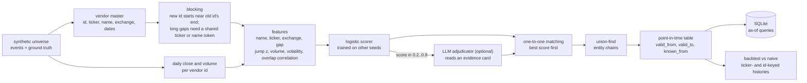

# security-master-resolver

[](https://github.com/Avinash186200/security-master-resolver/actions/workflows/ci.yml)
[](LICENSE)


A point-in-time security master: link every vendor security id and ticker to a permanent entity through renames, ticker reuse, mergers, spin-offs, relistings and id reissues, score the links against known ground truth, and show what the fix does to a backtest.

## Scenario

An asset manager's data team keeps years of daily prices and fundamentals keyed by the data vendor's security id and by ticker. Both change. A company renames and gets a new ticker; the vendor ends an id and starts a new one for the same company; a delisted company comes back under a new id; a new company picks up a ticker that a dead one used. Backtests then see stocks "dying" and "reappearing", lose returns across the change, or quietly pick up survivorship bias. The team wants a security master that maps every id to a permanent entity, with `valid_from` / `valid_to` dates, that they can query as of any date and audit.

This is a scenario to frame the work. All data here is synthetic, generated by code in this repo, so every true link is known and every number can be rebuilt.

## What it does

| part | what I built | how it is judged |
|---|---|---|
| universe | a generator of companies, vendor ids and corporate events: id reissue, rename with reissue, merger (acquirer reissued under a combined name), spin-off (parent reissued), delist and relist, ticker reuse by a different company (some within days), plus noisy names (suffix spellings, case, typos) and exchange changes. It records the true entity of every id | 731 companies, 1,201 vendor ids, 470 true links and 219 look-alike pairs on seed 100 |
| resolver | blocking on date window, ticker and name tokens; identifier features (fuzzy name, ticker, exchange, gap) and price-continuity features (return jump in sigmas, volume ratio, volatility ratio, return correlation while both ids trade); a logistic scorer trained on other seeds; one-to-one matching; union-find into entity chains; a point-in-time mapping table | pairwise precision / recall / F1, chain purity and completeness, exact chains, errors by event type |
| LLM adjudicator | optional: pairs with an ambiguous score go to an LLM that reads an evidence card. Vendor-neutral httpx adapter (`/chat/completions` shape); a deterministic mock in tests and CI | accuracy on the ambiguous band vs the model's own threshold |
| downstream | the same two strategies (equal weight, 12-1 momentum) on histories keyed by truth, by the resolver (final and as-known), by vendor id, by ticker, and by today's ticker list | return error and tracking error against the truth-keyed history, wrong-company joins, broken histories |
| output | a CLI and a SQLite table with as-of queries | ticker reuse and entity-history examples below |

## How it works



A link from old id A to new id B uses A's last 60 days and B's first 20 days. So the link is only knowable 20 business days after B starts; the table stores that date as `known_from`, and the as-known backtest uses a link only after it.

## Results

All numbers below are from synthetic data, copied from [results/RESULTS.md](results/RESULTS.md). `make bench` rebuilds them in about 50 seconds on a laptop CPU, and CI checks that a fresh run matches the committed JSON (with the versions in `constraints.txt`; I also checked it in a `python:3.11-slim` Linux container).

The scorers are trained on seeds 1-3 (22,734 candidate pairs, 1,513 same-company pairs) and scored on other seeds. Threshold 0.5 and the ambiguous band 0.2-0.8 were fixed before scoring. I looked at seed 100 while choosing the features, so the headline number is the mean over ten **held-out seeds (200-209)** that I did not look at while building. All seeds come from the same generator, so this is still an in-distribution test (see Limitations).

### 1. Resolution quality

**Held-out seeds 200-209, pairwise F1 mean (sd, range):**

| method | pairwise F1 | chain purity | chain completeness | exact chains |
|---|---|---|---|---|
| rule: same ticker, gap <= 7 days, jump <= 3 sigma | 0.697 (0.029, 0.661-0.754) | 0.999 | 0.848 | 0.522 |
| logistic, identifiers only | 0.793 (0.026, 0.747-0.837) | 0.989 | 0.898 | 0.665 |
| logistic, price continuity only | 0.943 (0.008, 0.929-0.955) | 0.998 | 0.967 | 0.882 |
| **logistic, combined** | **0.976** (0.008, 0.966-0.988) | 0.999 | **0.986** | **0.951** |
| combined + LLM adjudicator (mock) | 0.963 (0.008, 0.949-0.972) | 0.997 | 0.980 | 0.928 |

On the development seeds (100-104) the combined F1 is 0.975 (sd 0.005), and on seed 100 alone 0.975, so seed 100 is not a flattering pick: it sits at the held-out mean.

**Seed 100 in detail.** 6,885 candidate pairs after blocking; they contain all 470 true links (direct seams) and 500 same-company pairs in all (30 skip an id, A to C).

| method | links accepted | link precision | link recall | pairwise P | pairwise R | pairwise F1 | chain purity | chain completeness | exact chains |
|---|---|---|---|---|---|---|---|---|---|
| rule | 273 | 0.993 | 0.577 | 0.991 | 0.490 | 0.656 | 0.998 | 0.828 | 0.463 |
| identifiers only | 363 | 0.961 | 0.743 | 0.955 | 0.669 | 0.787 | 0.988 | 0.894 | 0.645 |
| price continuity only | 429 | 0.995 | 0.908 | 0.995 | 0.891 | 0.940 | 0.998 | 0.962 | 0.864 |
| **combined** | 453 | 0.996 | **0.960** | 0.997 | **0.954** | **0.975** | 0.998 | **0.983** | **0.941** |
| combined + mock LLM | 449 | 0.991 | 0.947 | 0.990 | 0.932 | 0.961 | 0.997 | 0.978 | 0.920 |

Link precision = accepted links joining two ids of the same company. Link recall = true seams accepted as direct links, out of 470 (no method accepted a skip link here). Pairwise metrics count every pair of ids in the same entity, so a missed link in the middle of a chain costs several pairs. Exact chains = share of the 324 multi-id companies rebuilt exactly.

### 2. Errors by event type (seed 100)

True links: share recovered (both ids end up in one chain). Look-alikes: share wrongly merged, among those that pass blocking.

| event | kind | n | rule | ids only | price only | combined | combined + mock LLM |
|---|---|---|---|---|---|---|---|
| id reissue | recovered | 262 | 99.6% | 100.0% | 100.0% | 100.0% | 100.0% |
| rename with new id and ticker | recovered | 134 | 0.0% | 32.1% | 100.0% | 96.3% | 86.6% |
| merger, acquirer reissued | recovered | 29 | 34.5% | 69.0% | 100.0% | 100.0% | 96.5% |
| spin-off, parent reissued | recovered | 18 | 0.0% | 100.0% | 11.1% | 100.0% | 100.0% |
| delist and relist | recovered | 27 | 0.0% | 22.2% | 0.0% | **48.1%** | 77.8% |
| ticker reused 20-400 days after it was freed | false merge | 73 | 0.0% | 0.0% | 0.0% | 0.0% | 1.4% |
| ticker reused 1-5 days after it was freed | false merge | 24 | **8.3%** | **29.2%** | 0.0% | 0.0% | 0.0% |
| merger target vs acquirer's new id | false merge | 29 | 0.0% | 20.7% | 0.0% | 0.0% | 0.0% |
| spin-off child vs parent | false merge | 18 | 0.0% | 0.0% | 0.0% | 0.0% | 0.0% |
| other false links (coincidences) | count | | 0 | 3 | 2 | 2 | 3 |

What I read from this:

- **Each signal fails where you would expect, and they cover each other.** Identifiers alone miss renames (new name, new ticker), merge some merger targets into the acquirer's new id, and merge 29% of tickers grabbed by a new company within days. Price continuity alone misses spin-off parents, whose unadjusted price drops 10-35% on the day, and every relisting, where months pass between the two series. Together: 0.975 F1 on seed 100, 0.976 on the held-out seeds.
- **The classic rule is precise but misses 42% of links,** and it is not immune to look-alikes: when a ticker is reused within a few days it merged 2 of 24 different companies (link precision 0.993). It cannot follow a ticker change at all.
- **Relistings are the weak spot.** The combined model recovers 13 of 27. With a gap of 40-300 days, the price evidence is weak and the name, ticker and exchange often change too.
- **The combined model merged no look-alike on seed 100**, including the quick ticker reuses: a different company's first price and volume rarely line up with the old one's. 15 of the 39 quick reuses do not reach the resolver at all, because the old id keeps trading under a new ticker; they matter for ticker-keyed histories (section 4), not for id linking.

### 3. Does the LLM adjudicator help? Not here.

On seed 100, 72 pairs fell in the ambiguous band (35 of them true links).

| decision on the band | accuracy |
|---|---|
| combined model, threshold 0.5 | 0.694 |
| mock adjudicator | 0.333 |

The mock fixed 13 decisions and broke 39, and F1 drops from 0.975 to 0.961 (held-out seeds: 0.976 to 0.963). It does help on relistings (48% to 78% recovered), because it gives more weight to name and ticker matches over long gaps, and it hurts on renames, where the name and ticker change by design and only the price says "same company".

**The adjudicator here is a deterministic mock, not a real LLM.** It applies fixed rules to the same evidence card a real model would get. Then, chosen by a hash of the card, 8% of its answers are flipped against its own rule with confidence 0.85 (to imitate confident mistakes), and 2% come back as prose to exercise the parser. Its numbers show that the adapter, the band, the parser and the scoring work end to end; they do not tell you what a real LLM would score. The repo is set up to measure one (see Quick start). What the mock does show is the bar a real model has to clear: the trained scorer is already right on 69% of the ambiguous pairs, and an adjudicator that sees the same evidence has to beat that, not 50%.

### 4. Downstream backtest (seed 100)

Equal weight in every eligible series (EW) and the top fifth by 12-1 momentum (MOM), rebalanced monthly from the end of the first year. Annualised; errors are against the truth-keyed history.

| history keyed by | EW return | EW error | EW tracking error | MOM return | MOM error | MOM tracking error | avg names (EW) | wrong-company joins | broken histories |
|---|---|---|---|---|---|---|---|---|---|
| truth (permanent entity) | 16.29% | - | - | 19.51% | - | - | 507 | 0 | 0 |
| resolver, final mapping | 16.31% | 0.02% | 0.06% | 19.61% | 0.10% | 0.20% | 506 | 2 | 19 |
| resolver, as known at each rebalance | 16.27% | -0.02% | 0.19% | 19.46% | -0.04% | 0.46% | 504 | 2 | 19 |
| rule baseline, final mapping | 16.33% | 0.05% | 0.28% | 19.85% | 0.34% | 0.71% | 489 | 2 | 199 |
| vendor id | 16.22% | -0.07% | 0.45% | 19.87% | 0.36% | 1.13% | 463 | 0 | 470 |
| ticker (every company that used it) | 16.86% | **+0.57%** | 1.64% | 19.16% | -0.35% | 1.41% | 493 | 172 | 255 |
| ticker, today's ticker list | 17.37% | **+1.09%** | 1.49% | 20.03% | +0.52% | **2.75%** | 397 | 172 | 255 |

- **Keying by ticker joins different companies 172 times.** When a ticker passes to a new company within a few days, the "return" across the join is the jump from one company's price to another's. That alone puts the equal-weight return 0.57% a year too high, with 1.64% tracking error. Ticker changes also break 255 histories.
- **Today's ticker list adds survivorship bias.** It drops companies that went bankrupt or were acquired (397 names on average vs 507), and the equal-weight error grows to +1.09% a year. Choosing the universe from tickers alive today is look-ahead: it uses the fact that a company survived.
- **Keying by vendor id breaks all 470 histories** at each reissue: positions go to cash and the "new" stock waits a year to have a momentum history (momentum tracking error 1.13%).
- **The resolver's history tracks the truth closely** (EW tracking error 0.06%, MOM 0.20%). Using only links known at each rebalance costs a little more (0.19% and 0.46%), because a continuation is only linked 20 days after the new id starts. That is the honest, point-in-time number.
- **The return errors depend on the generator's settings.** Here 21% of companies stop trading over 10 years: 9% go bankrupt and fall about 70% in their last six months, and 12% are acquired at a premium; 30% of new tickers are reused, and 40% of those reuses first look for a ticker freed in the last 1-5 business days. The per-name damage (wrong joins, broken histories, tracking error) is the more robust finding than any one return number.

### 5. As-of query

The combined resolver's mapping table for seed 100 has 1,373 rows (one per vendor id and ticker segment) and 748 resolved entities (731 true companies). From `make demo`:

```text
$ secmaster asof --db out/security_master.sqlite --ticker OVSK --date 2012-04-10
resolved_id     vid ticker                       name exchange valid_from   valid_to known_from  linked
     R00295 V762026   OVSK Westgate Logistics Company     XNYS 2012-01-02 2012-04-10 2012-01-02       1

$ secmaster asof --db out/security_master.sqlite --ticker OVSK --date 2017-01-09
resolved_id     vid ticker                name exchange valid_from   valid_to known_from  linked
     R00411 V362170   OVSK ORION MINERALS CORP     XNYS 2012-05-24 2021-08-27 2012-05-24       1

$ secmaster history --db out/security_master.sqlite --id R00005
resolved_id     vid ticker                           name exchange valid_from   valid_to known_from
     R00005 V105562   HMGG   Tamarack Semiconductor Group     XNAS 2012-01-02 2012-08-02 2012-01-02
     R00005 V542941    ISS         IRONWOOD SOFTWARE INC.     XNAS 2012-08-03 2013-10-09 2012-08-31
     R00005 V197982    ISS Ironwood Software Incorporated     XNAS 2013-10-10 2020-03-13 2013-11-07

$ secmaster history --db out/security_master.sqlite --id R00005 --known-on 2012-08-30
resolved_id     vid ticker                         name exchange valid_from   valid_to known_from
     R00005 V105562   HMGG Tamarack Semiconductor Group     XNAS 2012-01-02 2012-08-02 2012-01-02

$ secmaster asof --db out/security_master.sqlite --ticker ISS --date 2012-08-20 --known-on 2012-08-20
resolved_id     vid ticker                   name exchange valid_from   valid_to known_from  linked
    V542941 V542941    ISS IRONWOOD SOFTWARE INC.     XNAS 2012-08-03 2013-10-09 2012-08-31       0
```

Ticker OVSK belonged to one company until April 2012 and to a different one from May 2012. R00005 rebranded (new name, new ticker, new vendor id) in August 2012 and was reissued again in 2013. On 2012-08-20 the rebrand link was not yet knowable (it needs 20 days of the new series), so the as-known query returns the new id unlinked, as its own provisional entity (`resolved_id = vid`, `linked = 0`), instead of hiding a security that was trading.

The underlying SQL:

```sql
SELECT CASE WHEN known_from <= :known_on THEN resolved_id ELSE vid END AS resolved_id,
       vid, ticker, name, exchange, valid_from, valid_to, known_from,
       CASE WHEN known_from <= :known_on THEN 1 ELSE 0 END AS linked
FROM security_master
WHERE ticker = :ticker
  AND valid_from <= :as_of AND valid_to >= :as_of
  AND valid_from <= :known_on;
```

## Key concepts

- **Permanent id vs vendor id vs ticker.** A ticker is a label that moves between companies; a vendor id is the vendor's key and can be ended and reissued. The permanent id is what a backtest should key on, with a dated mapping from the other two.
- **Blocking, then scoring.** Comparing every pair of ids is quadratic and noisy. Candidates are restricted to ids that start within 10 days before to 300 days after another ends; beyond 5 days, they must share a ticker or a name token.
- **Two independent signals.** Identifiers (name, ticker, exchange) and price continuity (the first close of the new id against the last close of the old one, in units of the old id's daily volatility scaled by the square root of the gap; volume level; volatility; return correlation while both trade). Using log returns makes the jump test scale-free, unlike price differences.
- **One-to-one and union-find.** Each id gets at most one predecessor and one successor, taken best score first; that settles a merger where both old ids point at the new one. Union-find over accepted links gives chains A to B to C.
- **No leakage.** The scorer is fitted on other seeds; the threshold and band are fixed. Features read at most 20 days of the new series, so every link has a `known_from` date, and the as-known backtest only uses links known at each rebalance. Strategy positions at t use prices up to t; a test changes later prices and checks earlier returns do not move.
- **Vendor-neutral LLM.** The adjudicator only knows a `ChatAdapter`. The included adapter speaks the common `/chat/completions` JSON over httpx, with retry on 429 and 5xx, configured by environment variables.

## Quick start

```bash
pip install -c constraints.txt -e ".[dev]"   # exact versions the results were made with
pytest -q                                     # about 55 s, includes a full rerun against results/
make bench                                    # writes results/*.json and results/RESULTS.md
make demo                                     # generate seed 100, resolve into SQLite, run as-of queries
```

To try a real LLM on the ambiguous pairs, set `SECMASTER_LLM_BASE_URL`, `SECMASTER_LLM_MODEL` and, if needed, `SECMASTER_LLM_API_KEY`, then:

```bash
secmaster resolve --data data --db out/security_master.sqlite --model results/scorer_combined.json --llm openai
```

`--llm openai` means any server that speaks the `/chat/completions` JSON shape. Nothing in the tests or the committed results calls a real LLM. More detail in [docs/walkthrough.md](docs/walkthrough.md); the rules behind the numbers are in [docs/methodology.md](docs/methodology.md).

## Layout

```
src/secmaster/
  names.py        name generation, vendor spelling noise, normalisation, fuzzy similarity, tickers
  universe.py     synthetic companies, vendor ids, corporate events, prices, ground truth
  candidates.py   blocking and pair features (identifiers and price continuity)
  scorer.py       rule baseline and logistic scorers (ids only, price only, combined)
  adjudicator.py  evidence card, ChatAdapter, httpx adapter, verdict parser, deterministic mock
  resolver.py     ambiguous band, one-to-one matching, union-find, point-in-time mapping table
  evaluate.py     pairwise P/R/F1, chain purity and completeness, errors by event type
  backtest.py     keyed histories (truth, resolved, as-known, vendor id, ticker, today's tickers), EW and MOM
  store.py        SQLite table and as-of queries
  pipeline.py     training on seeds 1-3, resolving with each method
  bench.py        the full run and the RESULTS.md renderer
  cli.py          secmaster generate | resolve | asof | history | bench | report
tests/            unit tests per module, a small end-to-end run, a full rerun against results/
results/          JSON results, RESULTS.md, the trained combined scorer
docs/             methodology, walkthrough
```

## Limitations

- **Everything is synthetic, and the test is in-distribution.** The scorer is trained and tested on universes from the same generator with different seeds. The held-out seeds guard against my own choices overfitting seed 100, not against the generator being easier than real data. Real vendor data has failure modes I did not generate (share-class changes, cross-listings, CUSIP or ISIN changes without a ticker change, bad prints, partial-day overlaps), and real F1 would be lower. The 0.976 is a property of this generator.
- **Prices are already split-adjusted, and spin-offs are not.** I did not generate splits. Spin-off parents drop 10-35% on the day, which is why price-only scoring misses them; a real pipeline should use the vendor's adjustment factors before the jump test.
- **Relistings are only 48% recovered** (13 of 27 on seed 100). Long gaps leave little price evidence. A real system would add other identifiers (CUSIP, ISIN, legal entity id) for these, or send them to a review queue.
- **The LLM row is a mock.** I did not score a real LLM. The mock hurt overall here; a real model might do better or worse, and the repo can measure it.
- **The backtest effects depend on settings.** The ticker-keyed and survivorship errors (+0.57% and +1.09% a year) come from how often tickers are reused, how many companies die and how much they fall first, all of which I chose. The numbers show the direction and the mechanism, not a market-wide estimate.
- **No delisting returns.** A position in a series that stops trading goes to cash at the last close; real delisting returns (often negative) would make survivorship bias larger.
- **Ticker reuse within days is only partly realistic.** I let a new company take a ticker freed 1-5 business days earlier; real exchanges usually hold a ticker back for a while, but vendors can still show the old and new holder back to back. The combined model handled these here; the rule and identifier-only models did not.
- **Training labels are same-company pairs.** A skip pair (A to C when the true chain is A to B to C) is labelled positive for training, because linking it still puts the ids in the right chain; link recall counts only direct seams, so it is not inflated by skips.
- **Overlapping ids in one chain** are resolved by taking the id that started first; there is no price-quality rule.
- **Synthetic names and tickers** are random combinations of generic words and letters; any match with a real company or symbol is a coincidence.

## License

MIT. See [LICENSE](LICENSE).
